



<a href="https://github.com/sebiweise/security-workflows"></a>
<a href="https://github.com/sebiweise/devops-manager"></a>
<a href="https://github.com/sebiweise/solo-runner"></a>
<a href="https://rueckenwind-web.vercel.app"></a>
<a href="https://github.com/sebiweise/home-assistant-alamos"></a>
<a href="https://gemuetlich.goscinski.dev"></a>

<a href="https://goscinski.dev"></a>
<a href="https://www.linkedin.com/in/sebastian-weise"></a>
<a href="https://www.keoz.com"></a>
<a href="https://www.implet.com"></a>

Everything above is SVG, regenerated daily by [a GitHub Action](./.github/workflows/update-profile.yml) from the GitHub API, portrait and repo stats included. No third-party services.
