### `$ ls ~/projects`

- 🛡️ **[security-workflows](https://github.com/sebiweise/security-workflows)**: reusable GitHub Actions workflow that security-scans any repo with open-source tools only (Semgrep, Trivy, Gitleaks).
- 📊 **[DevOps Manager](https://github.com/sebiweise/devops-manager)**: self-hosted insights for GitHub repos, Actions and runners: run times, success rates, queue times and costs. `in development`
- 🏃 **[solo-runner](https://github.com/sebiweise/solo-runner)**: fresh, single-use self-hosted Actions runners for all private repos of a personal account, no organisation needed.
- 🧭 **[Rückenwind](https://github.com/sebiweise/rueckenwind)**: PWA that guides people with statutory health insurance in Germany towards a psychotherapy place. [Live ↗](https://rueckenwind-web.vercel.app)
- 🏠 **[Alamos for Home Assistant](https://github.com/sebiweise/home-assistant-alamos)**: Alamos alerting (aPager PRO, AMweb) as Home Assistant sensors and events, incl. alert feedback.
- 🔥 **Gemütlich**: turns a TV into a cosy room with a live-generated fireplace, weather and ambience scenes. [Live ↗](https://gemuetlich.goscinski.dev)

### `$ ./links.sh`

Panels regenerated daily by [a GitHub Action](./.github/workflows/update-profile.yml) from the GitHub API, portrait included. No third-party services.
